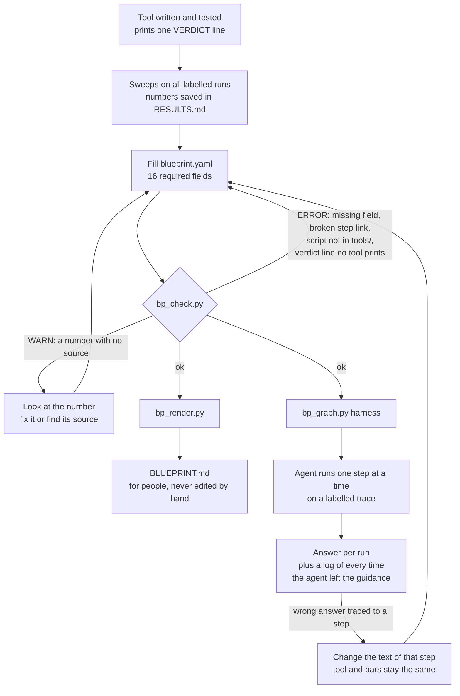
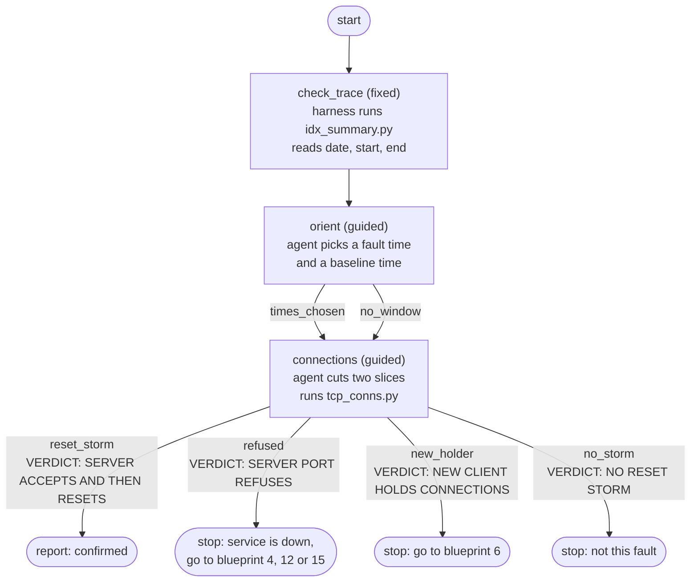

# How a `blueprint.yaml` is made and used (diagrams)

Companion to `METHOD.md`. Written 25-11-2026 for the supervisor meeting.

## 1. From tool to agent run

The yaml file sits in the middle. Everything before it produces checked numbers. Everything
after it is generated from it, so the text and the agent's steps cannot differ.

## 2. The steps inside one file (blueprint 22, `error_storm`)

A `fixed` step needs no model. A `guided` step lets the agent choose commands, but it must end
in one of the listed outcomes, and each outcome is tied to an exact verdict line that a tool
prints. (The file has a fifth outcome, `held_no_baseline`, left out here to keep the picture small.)
